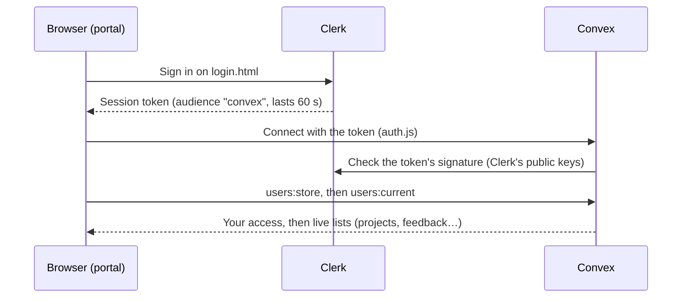

# Developer guide

How the Trodas project portal is built, how to set it up and run it, and how to change it safely.

For how people use it, see the [user guide](user-guide.md) and the [admin guide](admin-guide.md).

## Contents

- [How it fits together](#how-it-fits-together)
- [Current setup](#current-setup)
- [Run it locally](#run-it-locally)
- [Set up from scratch](#set-up-from-scratch)
- [Configuration reference](#configuration-reference)
- [Sign-in and access](#sign-in-and-access)
- [Data model](#data-model)
- [Convex functions](#convex-functions)
- [Command-line scripts](#command-line-scripts)
- [Making changes](#making-changes)
- [Deploying to production](#deploying-to-production)
- [Troubleshooting](#troubleshooting)
- [Recovering admin access](#recovering-admin-access)
- [Security notes](#security-notes)
- [Known limitations](#known-limitations)

## How it fits together

| Part | What it is | Where |
|---|---|---|
| Front end | Plain HTML, CSS and JavaScript. No framework, no build step. | `index.html`, `login.html`, `*.js`, `*.css`, `assets/` |
| Sign-in | [Clerk](https://clerk.com), invite-only | Clerk app **TRODAS** |
| Backend | [Convex](https://convex.dev): database, server functions and live updates | `convex/` |
| Local server | A small PowerShell static file server | `serve.ps1`, `start.bat` |



The browser never decides what someone may see. Every Convex function checks who is calling and what access they have before it returns or changes anything. Hiding pages in the browser is only for convenience.

## Current setup

| | Development | Production |
|---|---|---|
| Clerk app **TRODAS** | `finer-peacock-8466.clerk.accounts.dev` (development instance) | Not created yet |
| Convex project **trodas-portal** (team `nsaa-tickets`) | `clear-bandicoot-574` | `zealous-herring-182`: exists, not configured |
| `config.js` points to | Development | |
| Convex environment variables | `CLERK_ISSUER_URL`, `CLERK_SECRET_KEY` (invites are emailed) | None yet |

The development Convex deployment holds the live data in use today. Clerk development instances have usage limits and show a “Development mode” label, so move to production before real clients rely on the portal.

## Run it locally

Requirements: Windows with PowerShell (for `serve.ps1`), and Node.js 18 or newer for the Convex tools.

```powershell
cd "D:\tRodas\ellix project"
npm install
```

Start the portal by double-clicking `start.bat`, or:

```powershell
powershell -ExecutionPolicy Bypass -File .\serve.ps1
```

Then open <http://localhost:5500>. You’re sent to `login.html` until you sign in. Add `-NoBrowser` to start without opening a browser tab.

- `serve.ps1` serves this folder on port 5500. It refuses to serve `node_modules`, `convex`, `data`, `scripts`, `.git`, `.env.local` and `package*.json`.
- Sign-in needs http, so opening `index.html` straight from disk doesn’t work.
- Run npm commands from this folder. Elsewhere, npm can’t find `package.json`.

Without Clerk configured, the login page explains what’s missing. Without `convexUrl`, the portal runs as a demo with sample data stored only in the browser.

## Set up from scratch

Follow this for a new environment, for example a new developer’s machine with their own deployment, or production (see also [Deploying to production](#deploying-to-production)).

### 1. Clerk

In the [Clerk dashboard](https://dashboard.clerk.com):

1. **Create an application** (email sign-in is enough; Google is optional).
2. **Configure → API keys:** copy the **Publishable key** into `config.js` as `clerkPublishableKey`.
3. **Configure → Access mode:** choose **Invite-only**. To create your own first account, leave it on *Open* until you’ve signed up, then switch.
4. **Configure → Integrations → Convex:** turn it on. This makes Clerk’s session tokens carry the audience `convex`. Note the **Frontend API URL** (for example `https://your-app-12.clerk.accounts.dev`).
5. **Configure → Sessions → Customize session token:** keep the `aud` claim the Convex integration added, and add `name`, `email` and `picture`, so the result looks like this:

   ```json
   {
     "aud": "convex",
     "name": "{{user.full_name}}",
     "email": "{{user.primary_email_address}}",
     "picture": "{{user.image_url}}"
   }
   ```

   Invites, the Admin page and `convex:grant` all rely on the email claim.

### 2. Convex

```powershell
npx convex dev
```

The first run asks you to log in and choose or create a project, then stops because `CLERK_ISSUER_URL` isn’t set. Set it to the Frontend API URL from step 1.4, then deploy:

```powershell
npx convex env set CLERK_ISSUER_URL https://your-app-12.clerk.accounts.dev
npx convex dev --once
```

This writes `.env.local` (which deployment this folder uses; keep it out of git) and generates `convex/_generated/` (commit it). Copy `CONVEX_URL` from `.env.local` into `config.js` as `convexUrl`.

### 3. Load the starting data (once)

```powershell
npm run convex:import-all
```

This loads the sample data from `convex/samples.ts`: six projects for small Ghanaian businesses (Sankofa Delivery, Osu Bakery & Café, Tema Harbour Logistics, Ridge Dental Clinic, Volta Grains Co-operative, Kumasi Hardware Centre), each with a five-phase delivery timeline, plus client feedback, shared documents and recent activity. It also removes the older placeholder samples (Acme Corporation and others) if they’re still there. Running it again skips what’s already loaded. `npm run convex:samples` does the same. To import your own projects from a JSON file instead, use `npm run convex:import-projects -- path/to/file.json`.

### 4. Make yourself an admin (once)

Sign in to the portal once. You’ll see “Your account is waiting for access”. Then:

```powershell
npm run convex:grant -- you@yourcompany.com admin
```

Reload. From now on, admins manage access on the **Admin** page.

### 5. Email invites from the Admin page

Optional but recommended. Without it, the Admin page saves invites but sends no email.

In Clerk, go to **Configure → API keys → Secret keys** and copy the key (`sk_test_…` or `sk_live_…`). Then, **from this folder**:

```powershell
npx convex env set CLERK_SECRET_KEY sk_test_your_key_here
```

It should answer `Successfully set CLERK_SECRET_KEY (on dev deployment …)` and name this project’s deployment. If it names another deployment, you ran it in another folder. To see which variables a deployment has (names only):

```powershell
npx convex env list
```

### 6. Check it

```powershell
npm run check:integrations
```

See [`check:integrations`](#checkintegrations) for what it checks. Then open the portal: the top bar should say **Live · Convex**.

## Configuration reference

### `config.js` (loaded by the browser, so public)

`config.js` has a `development` block and a `production` block. The portal picks one from the address it’s opened at: `localhost` or `127.0.0.1` uses development; any other address uses production. The same files therefore work locally and on the hosted site.

| Key | Value | Notes |
|---|---|---|
| `clerkPublishableKey` | `pk_test_…` (development) or `pk_live_…` (production) | Public by design. Encodes the Clerk Frontend API address. Empty: the sign-in page says sign-in isn’t set up. |
| `convexUrl` | `https://<deployment>.convex.cloud` | Public by design. Empty means demo mode. |

`npm run check:integrations` checks the development block; `-- --prod` checks the production block.

### Convex environment variables (server only)

Set them with `npx convex env set NAME value` (add `--prod` for production) or in the Convex dashboard under **Settings → Environment Variables**.

| Name | Required | What it does |
|---|---|---|
| `CLERK_ISSUER_URL` | Yes | The Clerk Frontend API URL. Convex accepts only tokens issued by it. |
| `CLERK_SECRET_KEY` | For emailed invites | Lets `invites:send` and `invites:revoke` call Clerk’s Backend API. Never put it in `config.js`. |
| `CLERK_API_URL` | No: testing only | Points invite calls at a stand-in for Clerk. Leave unset. `check:integrations` warns if it’s set. |

### `.env.local` (written by `npx convex dev`, not committed)

`CONVEX_DEPLOYMENT` (which deployment this folder deploys to), `CONVEX_URL` and `CONVEX_SITE_URL`.

## Sign-in and access

### Files involved

| File | Job |
|---|---|
| `login.html`, `login.js`, `login.css` | The sign-in page. Mounts Clerk’s sign-in form with no sign-up link. An invitation link (`?__clerk_ticket=…&__clerk_status=sign_up`) gets Clerk’s sign-up form instead. |
| `auth.js` | Loads Clerk from your Frontend API, keeps redirects on this site, and connects Convex with Clerk’s token. It reads the token’s audience: `convex` means Clerk’s Convex integration; otherwise it falls back to a JWT template named `convex`, for older setups. |
| `session.js` | Keeps `index.html` behind sign-in, shows the signed-in person, mounts Clerk’s account menu, calls `users:store`, and hands the connection to `app.js`. |
| `app.js` | Reads the person’s access from `users:current` and subscribes to the lists they’re allowed to see. |
| `convex/auth.config.ts` | Tells Convex to trust tokens from `CLERK_ISSUER_URL` with audience `convex`. |
| `convex/access.ts` | The shared access rules, client-name matching, and the access log helper. |

### What happens on sign-in

1. Clerk signs the person in and issues a short-lived token (60 seconds). The Convex client asks for a fresh one before it expires.
2. Convex checks the token’s issuer, audience and signature.
3. `users:store` creates or updates the person’s `users` row (name, email, picture, last sign-in). If they have no access yet and a pending invite matches their email, the invite’s access is applied and the invite is marked accepted.
4. `users:current` tells the portal their access. Admins and the team get the team view; clients are locked to their company’s view; anyone else sees “waiting for access”.

### Access rules (`convex/access.ts`)

| Helper | Allows | Refuses with |
|---|---|---|
| `requireAccess` | admin, team, or a client with a company | “Sign in first.” / “Your account is waiting for access…” |
| `requireTeam` | admin, team | “Only the Trodas team can do this.” |
| `requireAdmin` | admin | “Only admins can do this.” |

Every public function starts with one of these. List functions return everything to admins and the team, and only the caller’s company’s rows to clients (using the `by_client` index).

Also enforced on the server:

- **Your own access:** admins can’t change it.
- **Last admin:** the portal keeps at least one.
- **Client names:** must be on the client list (`requireClient`). Only admins can add a client, including while creating a project.
- **Activity entries:** written only by the server, inside the mutation that makes the change.
- **Access changes:** recorded in `auditLog`.

## Data model

Defined in `convex/schema.ts`. Client companies are stored by name on each record. `clients.key` is the lower-cased name used for matching, and renaming a client updates the name everywhere.

| Table | Holds | Key fields | Indexes |
|---|---|---|---|
| `users` | Everyone who has signed in | `tokenIdentifier`, `name`, `email`, `role` (`admin`/`team`/`client`/none), `client`, `lastSignedInAt` | `by_token` |
| `projects` | Projects | `name`, `client`, `status`, `progress` (0–100), `deadline` (YYYY-MM-DD), `lead`, `description`, `symbol`, `color`, `legacyId`, `archived`, `milestones` (phases: `title`, `start`, `end`, `done`) | `by_legacy_id`, `by_client` |
| `feedback` | Client feedback | `author`, `client`, `projectLegacyId`, `text`, `date`, `status` (`Needs review`/`Reviewed`) | `by_client`, `by_project_legacy` |
| `activity` | Recent activity feed | `actor`, `action`, `context`, `client`, `createdAt` | `by_client`, `by_created_at` |
| `resources` | Shared documents: written text, or a file in Convex storage | `name`, `description`, `type`, `client`, `projectLegacyId`, then `body` or `fileId`/`fileName`/`fileType`/`fileSize` | `by_client`, `by_project_legacy` |
| `clients` | Client companies | `name`, `key` | `by_key` |
| `invites` | Access decided before first sign-in | `email` (lower-cased), `role`, `client`, `status` (`pending`/`accepted`/`revoked`), `invitedByName`, `emailSent`, `clerkInvitationId` | `by_email`, `by_status` |
| `auditLog` | Access log | `actorName`, `actorId`, `action`, `createdAt` | `by_created_at` |

The portal refers to a project by its old id (`p1`, `p2`…, kept in `legacyId`) if it was imported, otherwise by its Convex id. Feedback and resources store that id in `projectLegacyId`. `projectAppId` and `findProjectByAppId` in `convex/access.ts` convert between the two.

A project’s client decides who sees its feedback and resources: their `client` field copies the project’s. Moving a project to another client (`projects:edit`) moves them too.

## Convex functions

“Staff” means admin or team. *Internal* functions can’t be called from the browser, only from the command line or other functions.

| Function | Type | Who | What it does |
|---|---|---|---|
| `users:store` | mutation | anyone signed in | Create or refresh your user row; apply a matching pending invite |
| `users:current` | query | anyone | Your profile and access, or `null` |
| `users:list` | query | admin | Everyone who has signed in |
| `users:staff` | query | staff | Admins and team members, for project leads and the Team page |
| `users:setAccess` | mutation | admin | Change someone’s access (not your own; never the last admin) |
| `users:grantAccess` | internal | command line | Set access by email (`convex:grant`) |
| `invites:send` | action | admin | Save or update an invite; email it through Clerk if `CLERK_SECRET_KEY` is set |
| `invites:revoke` | action | admin | Cancel a pending invite in Convex and in Clerk |
| `invites:list` | query | admin | Pending invites, and whether emailing is set up |
| `clients:list` | query | staff | The client list |
| `clients:create` / `rename` / `remove` | mutation | admin | Manage clients; rename updates every table; renaming to an existing name merges |
| `clients:syncFromProjects` | internal | command line | Add clients used by projects and accounts; unify spellings |
| `audit:list` | query | admin | Latest 100 access-log entries |
| `projects:list` | query | everyone with access | Staff: all, archived ones included; clients: their company’s current projects |
| `projects:create` | mutation | staff | Create a project (client must be on the list; admins may add one) |
| `projects:update` | mutation | staff | Change status and progress (Completed means 100%) |
| `projects:edit` | mutation | staff | Change name, client, deadline, lead and description; a new client takes the project’s feedback and resources with it |
| `projects:setArchived` | mutation | staff | Archive or restore a project |
| `projects:remove` | mutation | admin | Delete an archived project with its feedback, resources and files |
| `projects:setTimeline` | mutation | staff | Replace a project’s timeline (1–10 phases; each ends on or after it starts) |
| `projects:setMilestoneDone` | mutation | staff | Mark one phase done or reopen it (recorded in activity) |
| `samples:load` | internal | command line | Load the sample projects with timelines; remove old placeholders |
| `feedback:list` | query | everyone with access | Staff: all; clients: their company’s |
| `feedback:review` | mutation | staff | Mark feedback reviewed |
| `feedback:create` | mutation | everyone with access | Share feedback on a project the caller can see; the author is always the caller |
| `feedback:remove` | mutation | admin | Delete a feedback item (logged) |
| `activity:list` | query | everyone with access | Latest entries (default 30, at most 100), company-scoped for clients |
| `resources:list` | query | everyone with access | Staff: all; clients: their company’s; files come with a `url` |
| `resources:generateUploadUrl` | mutation | staff | A one-time upload link for a file |
| `resources:create` | mutation | staff | Share written text or an uploaded file (up to 25 MB) on a project |
| `resources:remove` | mutation | staff | Remove a resource and its file |
| `*:importLegacy` | internal | command line | Used by the import scripts |

## Command-line scripts

Run from the project folder. Add `-- --prod` to use the production deployment.

| Command | What it does |
|---|---|
| `npm run convex` | `convex dev`: watch `convex/` and deploy changes to your dev deployment |
| `npm run convex:deploy` | Deploy `convex/` to production |
| `npm run typecheck` | Type-check `convex/` |
| `npm test` | Run the automated tests (`tests/`) in memory; touches no deployment |
| `npm run convex:import-all` / `npm run convex:samples` | Load the sample projects (with timelines), feedback, documents and activity |
| `npm run convex:import-projects -- [file]` | Import only projects, from `data/projects.json` or the file given |
| `npm run convex:grant -- <email> <admin\|team\|client\|none> ["Company"]` | Set someone’s access. For an email that hasn’t signed in yet, it saves a pre-approval that applies at their first sign-in (no email is sent) |
| `npm run check:integrations` | Check the whole Clerk and Convex setup; changes nothing |
| `npx convex run clients:syncFromProjects` | Refill the client list from projects and accounts |
| `npx convex env list` | Names of the deployment’s environment variables |

### `check:integrations`

Read-only. It reports ✔ (fine), ! (warning) or ✖ (problem, with a fix), and exits with code 1 if anything fails, so you can run it before a deploy. It checks:

- `config.js` has a valid Clerk key and Convex address, matching `.env.local`
- Convex trusts the same Clerk app the portal signs in with (`CLERK_ISSUER_URL`)
- Clerk publishes its signing keys, and sign-up is invite-only
- `CLERK_SECRET_KEY` is set and belongs to the same Clerk app (warning if missing)
- at least one admin exists
- every function in `convex/` is deployed
- Convex refuses requests with no sign-in or a forged one

It can’t check a real signed-in token. For that, open the portal and look for **Live · Convex**.

## Making changes

**Front end:** edit the files, then reload the browser. There’s no build. Live updates mean the page re-renders whenever data changes, so keep form values in state (see `drafts` in `app.js`) rather than only in the DOM.

**Backend:** keep `npx convex dev` running while you work; it type-checks and deploys every change to your dev deployment. Or deploy once:

```powershell
npx convex dev --once
```

**A new server function should:**
1. Start with `requireAccess`, `requireTeam` or `requireAdmin`.
2. Return only the caller’s company’s rows to clients.
3. Check its inputs (see `cleanText`, `cleanEmail`, `requireClient`).
4. Call `audit(...)` if it changes access or clients.

`check:integrations` lists any function that isn’t deployed, and confirms list functions refuse requests without a sign-in. Add new list functions to its list.

**Automated tests:** `tests/portal.test.ts` runs the real Convex functions in memory with [convex-test](https://docs.convex.dev/testing/convex-test). Each test starts from an empty database with an admin, a team member, and clients at two companies, then checks who can see and change what: access, invites (with Clerk stubbed out), client renames, projects, feedback, resources and activity. Run it with `npm test`; it takes a few seconds and touches no deployment. Add a test whenever you add or change a rule.

**Trying risky changes:** each developer who runs `npx convex dev` against the `trodas-portal` project gets their own dev deployment, so you don’t touch the shared data. Set `CLERK_ISSUER_URL` on it and import the starting data first.

**Before committing:** run `npm test`, `npm run typecheck` and `npm run check:integrations`, and click through the pages you changed as an admin, a team member and a client.

## Deploying to production

1. **Clerk production instance.** In the TRODAS app, create the production instance (it needs a domain you control and some DNS records). Confirm it has invite-only access mode, the Convex integration and the session token claims from [setup step 1](#1-clerk). Note its Frontend API URL (`https://clerk.yourdomain.com`), its `pk_live_…` publishable key and its `sk_live_…` secret key.
2. **Convex production deployment:**
   ```powershell
   npx convex env set CLERK_ISSUER_URL https://clerk.yourdomain.com --prod
   npx convex env set CLERK_SECRET_KEY sk_live_your_key --prod
   npm run convex:deploy
   ```
3. **`config.js`:** put the `pk_live_…` key in the `production` block. Its `convexUrl` is already `https://zealous-herring-182.convex.cloud`. The development block stays as it is; the portal picks the block by address.
4. **Data and the first admin:**
   ```powershell
   npm run convex:import-all -- --prod
   npm run convex:grant -- you@yourcompany.com admin --prod
   ```
   Sign in to the production portal once before running the grant.
5. **Host the front end** on any static host (Cloudflare Pages, Netlify, an IIS or nginx site). Publish only the front-end files: `index.html`, `login.html`, `app.js`, `auth.js`, `session.js`, `login.js`, `config.js`, `styles.css`, `login.css`, `fonts.css`, `favicon.svg` and `assets/`. Don’t publish `node_modules`, `convex`, `data`, `scripts`, `.env.local` or `package*.json`.
6. **In Clerk production,** add the portal’s domain and set **Configure → Paths** home URL to it.
7. **Check:**
   ```powershell
   npm run check:integrations -- --prod
   ```

## Troubleshooting

| Symptom | Likely cause | Fix |
|---|---|---|
| Portal says Convex didn’t accept your sign-in | The Convex integration is off in Clerk, or `CLERK_ISSUER_URL` doesn’t match the Clerk app | Run `npm run check:integrations`; follow its fix |
| Stuck on “Still connecting to Convex…” | Wrong `convexUrl`, or no internet connection | Check `config.js` against `.env.local` |
| People appear as “Portal user” with no email | The session token is missing the `name`/`email` claims | Clerk setup step 1.5 |
| Invited person sees “waiting for access” | They signed in with a different email, or the invite was cancelled | Admin page: give that account access, or re-invite the right address |
| Admin page shows **Save invite**, not **Send invite** | No `CLERK_SECRET_KEY` on this deployment | Setup step 5; check with `npx convex env list` |
| Invite link says “You’re already signed in” | That browser is signed in as someone else | **Sign out and accept**, or use a private window |
| `npm error … Could not read package.json` | npm was run outside the project folder | `cd "D:\tRodas\ellix project"` first |
| `check:integrations`: “Not deployed yet: …” | `convex/` changed but wasn’t deployed | `npx convex dev --once` |
| `serve.ps1`: “Could not start on port 5500” | Another server is using the port | Close it, or stop the other `serve.ps1` window |
| Convex CLI prints `Assertion failed … async.c` after a command on Windows | A known Node/Windows exit quirk in the CLI | Harmless if the command’s result printed |
| `git` says “dubious ownership” | The D: drive doesn’t record file owners | `git config --global --add safe.directory "D:/tRodas/ellix project"` |

## Recovering admin access

If no admin can sign in (they left, lost their account, or were demoted by mistake), anyone who can deploy to the Convex project can restore one. The person must have signed in to the portal at least once.

```powershell
cd "D:\tRodas\ellix project"
npm run convex:grant -- someone@yourcompany.com admin
```

Add `--prod` for production. The change appears in the access log as **Command line**. The same command sets `team`, `client "Company"` or `none`.

## Security notes

- **Secret:** only `CLERK_SECRET_KEY`. It lives in Convex environment variables and nowhere else. The publishable key and Convex URL in `config.js` are public by design.
- **Not committed:** `.env.local` and `node_modules/` are in `.gitignore`. Keep the GitHub repository private: the code and sample data name clients.
- **Where access is decided:** only by Convex functions. The redirect to `login.html` and hidden pages are convenience, not protection.
- **Uploaded files** are served from Convex storage at long, unguessable links. The portal only gives a link to people allowed to see the resource, but anyone they pass it on to can open it. Removing the resource deletes the file.
- **Tokens** last 60 seconds. Convex rejects expired, tampered or forged tokens (`check:integrations` tests the forged case).
- **Invites** are matched on the email from Clerk’s token. Clerk only lets a verified address be someone’s primary email, and invite-only accounts start from the invited address.
- **Removing someone:** set them to *Waiting for access*. To stop them signing in at all, also delete them in Clerk.

## Known limitations

- **Sample data:** the six sample projects and their feedback, documents and activity are for demos. Admins can delete sample feedback, the team can remove sample resources and archive or delete sample projects.
- **Sample leads:** sample projects name leads who have no portal account (Kwame Asante, Efua Owusu, Yaw Darko, Adwoa Boateng). The Team page lists them as “no portal account”. Edit a project to pick a real lead.
- **Files are shared, not versioned:** to update a document, remove it and add the new version.
- **Production isn’t set up yet:** Clerk’s production instance needs your domain (see [Deploying to production](#deploying-to-production)). Until then, Clerk shows a “Development mode” label and has usage limits.
